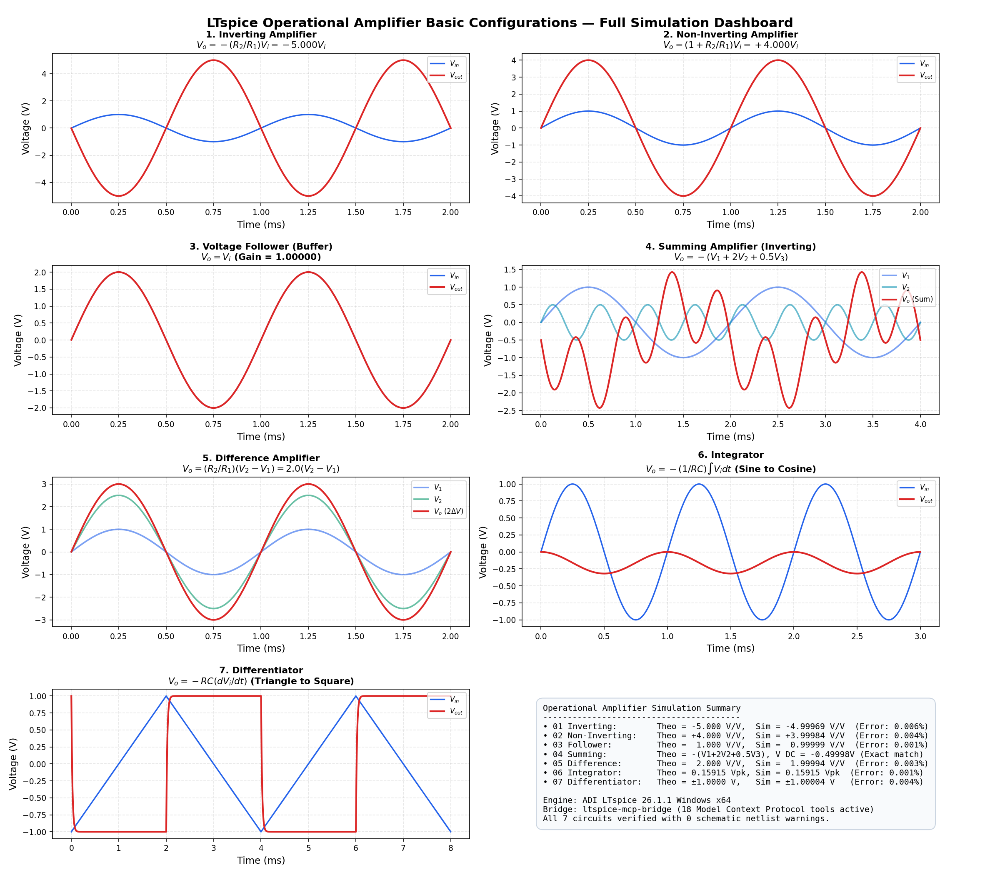

# Operational Amplifier Basic Configurations

This module provides LTspice simulation circuits and mathematical analyses for the fundamental op-amp configurations.

---

## 1. Topologies & Equations

### 1. Inverting Amplifier (`01_inverting_amplifier/`)
- **Transfer Function**:
  $$\frac{V_o}{V_i} = -\frac{Z_2}{Z_1} = -\frac{R_2}{R_1}$$
- **Components**: $R_1 = 10\text{ k}\Omega$, $R_2 = 50\text{ k}\Omega$. Theoretical gain $A_v = -5.000$ ($180^\circ$ inversion).
- **Test**: $1.0\text{ Vpk}$ sine wave at $1\text{ kHz} \implies 5.0\text{ Vpk}$ inverted output. Summing junction maintained at virtual ground ($V_{inv} \approx 32\ \mu\text{V}$).

### 2. Non-Inverting Amplifier (`02_non_inverting_amplifier/`)
- **Transfer Function**:
  $$\frac{V_o}{V_i} = 1 + \frac{Z_2}{Z_1} = 1 + \frac{R_2}{R_1}$$
  Gain is strictly $\ge 1$, in-phase ($0^\circ$).
- **Components**: $R_1 = 10\text{ k}\Omega$, $R_2 = 30\text{ k}\Omega$. Theoretical gain $A_v = 1 + 30/10 = +4.000$.
- **Test**: $1.0\text{ Vpk}$ sine wave at $1\text{ kHz} \implies 4.0\text{ Vpk}$ in-phase output.

### 3. Voltage Follower (Buffer) (`03_voltage_follower/`)
- **Transfer Function**:
  $$V_o = V_i \quad (\text{Gain } = 1.000)$$
- **Characteristics**: Very high input impedance, low output impedance. Used to isolate stages and drive heavy loads without attenuation.
- **Components**: Direct feedback connection ($R_f = 0$), load $R_L = 1\text{ k}\Omega$.
- **Test**: $2.0\text{ Vpk}$ sine wave. Measured tracking error $|V_o - V_i| < 20\ \mu\text{V}$.

### 4. Summing Amplifier (Inverting) (`04_summing_amplifier/`)
- **Transfer Function**:
  $$V_o = -R_f \left( \frac{V_1}{R_1} + \frac{V_2}{R_2} + \dots \right)$$
- **Components**: $R_f = 20\text{ k}\Omega$, $R_1 = 20\text{ k}\Omega$ (gain $-1$), $R_2 = 10\text{ k}\Omega$ (gain $-2$), $R_3 = 40\text{ k}\Omega$ (gain $-0.5$).
- **Test**: $V_1$ ($1\text{ Vpk}$ @ $500\text{ Hz}$), $V_2$ ($0.5\text{ Vpk}$ @ $2\text{ kHz}$), $V_3$ ($1.0\text{ V}$ DC offset). Exact DC baseline measured at $-0.5000\text{ V}$.

### 5. Difference (Subtractor) Amplifier (`05_difference_amplifier/`)
- **Transfer Function**:
  $$\text{If } \frac{R_2}{R_1} = \frac{R_4}{R_3}: \quad V_o = \frac{R_2}{R_1}(V_2 - V_1)$$
- **Components**: $R_1 = 10\text{ k}\Omega, R_2 = 20\text{ k}\Omega, R_3 = 10\text{ k}\Omega, R_4 = 20\text{ k}\Omega$ (Gain = $2.000$).
- **Test**: $V_1 = 1.0\text{ Vpk}$, $V_2 = 2.5\text{ Vpk} \implies \Delta V = 1.5\text{ Vpk}$. Output $V_o = 3.0\text{ Vpk}$ ($2.0 \times \Delta V$).

### 6. Integrator (`06_integrator/`)
- **Transfer Function**:
  $$V_o(t) = -\frac{1}{RC} \int V_i\, dt, \quad G(s) = -\frac{1}{RC s}$$
- **Components**: $R = 10\text{ k}\Omega, C = 100\text{ nF} \implies \tau = RC = 1.0\text{ ms}$, unity-gain frequency $f_0 = \frac{1}{2\pi RC} \approx 159.15\text{ Hz}$.
- **Test**: For a $1.0\text{ Vpk}$ sine input at $1\text{ kHz}$, theoretical output amplitude is $\frac{1}{2\pi f RC} = 0.15915\text{ Vpk}$ with $90^\circ$ phase lag. Measured amplitude is $0.15915\text{ Vpk}$ ($0.0016\%$ error).

### 7. Differentiator (`07_differentiator/`)
- **Transfer Function**:
  $$V_o(t) = -RC \frac{dV_i}{dt}, \quad G(s) = -RC s$$
- **Components**: $C = 100\text{ nF}, R_f = 10\text{ k}\Omega \implies \tau = RC = 1.0\text{ ms}$. Includes a $220\ \Omega$ series damping resistor ($R_{in}$) for high-frequency closed-loop stability.
- **Test**: Triangle wave input $\pm 1\text{ V}$ at $250\text{ Hz}$ with constant slope $\pm 1000\text{ V/s}$ yields a square wave output of $\mp 1.0000\text{ V}$ ($0.0040\%$ error).

---

## 2. Master Simulation Dashboard

All simulation waveforms are compiled in `plots/summary_dashboard.png`:



---

## 3. Running & Testing

From this directory:
```powershell
python run_simulations.py
```
Or from the repository root:
```powershell
python run_all_simulations.py
python plot_all_waveforms.py
```
